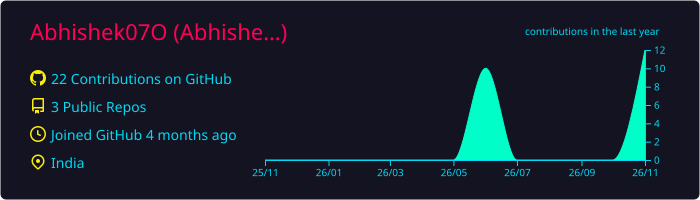
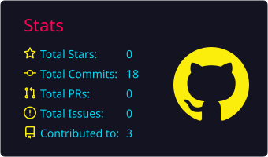
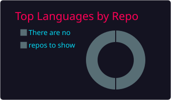
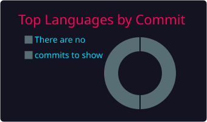
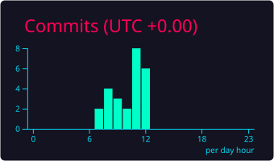

# Hi 👋, I'm Abhishek Dwivedi
## 🚀 About Me

- 📊 Aspiring Data Analyst passionate about turning data into actionable insights.
- 🌱 Currently learning Advanced SQL and Machine Learning.
- 💼 Open to Data Analyst Internship Opportunities.
- 📫 Reach me at: abhishekdwivedi9945@gmail.com.

  ## 🛠 Skills

### Languages & Databases
- SQL
- Python
- MySQL

### Data Analysis
- Pandas
- NumPy

### Data Visualization
- Matplotlib
- Seaborn
- Power BI
- Excel

### Tools
- Git
- GitHub
- Jupyter Notebook

## 💻 Tech Stack

## 📂 Featured Projects

### 🍕 Pizza Sales Analysis using SQL

**Tools:** MySQL | SQL

- Analyzed pizza sales data using SQL to identify business trends and sales performance.
- Solved 13 business questions using SQL queries.
- Calculated total orders, revenue, and pizza quantities.
- Identified top-selling pizzas and highest-revenue categories.
- Analyzed hourly order patterns and daily sales trends.
- Used JOINs, Subqueries, Aggregate Functions, CTE-style derived tables, and Window Functions.

🔗 **[View Project Repository](https://github.com/Abhishek07O/pizza-sales-sql-analysis)**

## 📊 GitHub Statistics

